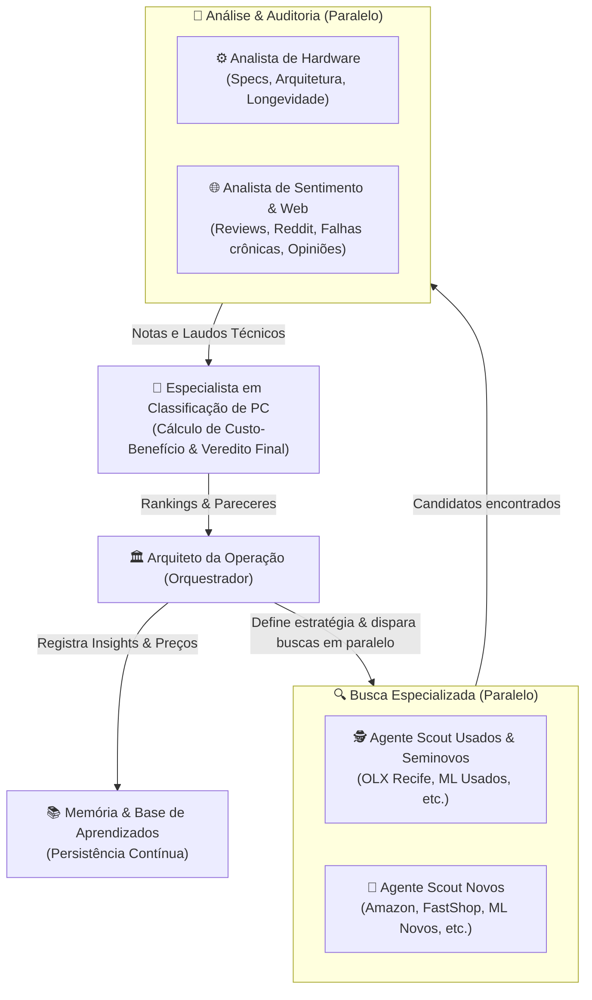

# 🖥️ Busca-PC: Plataforma Agêntica Multiagente para Avaliação & Busca de Computadores

Sistema agêntico colaborativo e paralelo projetado para localizar, auditar, classificar e ranquear computadores novos, seminovos e usados com máxima precisão técnica e de mercado.

---

## 🏛️ Arquitetura dos Agentes

O ecossistema opera sob a liderança do **Arquiteto da Operação**, com execução concorrente/paralela:



### 👥 Papéis e Responsabilidades

1. **🏛️ Arquiteto da Operação (`OperationArchitect`)**:
   - Direciona a estratégia e define o escopo da missão.
   - Ponto focal ao qual os demais agentes recorrem para instruções e próximos passos.
   - Orquestra o ciclo de vida: busca paralela ➔ análise paralela ➔ classificação ➔ síntese.

2. **🕵️ Scout de Usados e Seminovos (`UsedScoutAgent`)**:
   - Especializado em garimpar ofertas no mercado secundário (OLX, marketplaces locais, plataformas P2P).
   - Filtra anúncios por localidade (ex: Recife/PE), estado físico declarado, ciclos de bateria e confiabilidade do vendedor.

3. **🏬 Scout de Novos (`NewScoutAgent`)**:
   - Especializado no varejo tradicional e lojas oficiais (Amazon, Magazine Luiza, Mercado Livre Oficial, Fast Shop).
   - Monitora preços à vista, parcelamento, garantia oficial e frete.

4. **⚙️ Analista de Hardware (`HardwareAnalystAgent`)**:
   - Avalia CPU/GPU/SoC, RAM unificada, barramentos, armazenamento NVMe, tela, portas e eficiência térmica.
   - Concede uma **Nota de Hardware (0 a 100)** fundamentada em métricas objetivas (ex: Apple Silicon vs Intel, limitações de 8GB RAM).

5. **🌐 Analista de Sentimento e Comunidade (`SentimentAnalystAgent`)**:
   - Varre fóruns técnicos, Reddit, YouTube e portais de reparo em busca de problemas crônicos (ex: *Flexgate*, teclado borboleta, throttling térmico, descolamento de tela).
   - Concede uma **Nota de Sentimento/Confiabilidade (0 a 100)** baseada na experiência real de proprietários.

6. **🎯 Especialista em Classificação de PC (`PCClassifierAgent`)**:
   - Cruza a Nota de Hardware, a Nota de Sentimento e o Preço de Mercado.
   - Calcula o **Índice de Custo-Benefício (ICB 0-100)** e atribui a classificação em faixas (**Tier S, A, B, C, F**) com recomendação clara (Recomendado, Bom Negócio, Neutro, Não Recomendado).

7. **📚 Base de Aprendizados e Memória (`KnowledgeBase`)**:
   - Registra todos os aprendizados, faixas de preço de mercado em Recife/PE, modelos reprovados e dicas de negociação para alimentar iterações futuras.

---

## 🚀 Instalação e Execução

### Opção 1: Rodando Tudo em Containers Docker (Recomendado)
O ecossistema completo (banco de dados PostgreSQL 16 + aplicação Web com FastAPI e orquestrador agêntico) sobe com um único comando:

```bash
docker compose up --build -d
```

- **Website / Dashboard Interativo:** [http://localhost:8000](http://localhost:8000)
- **Documentação Interativa Swagger API:** [http://localhost:8000/docs](http://localhost:8000/docs)
- **Banco PostgreSQL:** Porta mapeada `127.0.0.1:5442` (internamente na rede docker `db:5432`).

### Opção 2: Execução Local via CLI com UV
```bash
git clone https://github.com/felipedemacedo/busca-pc.git
cd busca-pc
uv sync
uv run python -m busca_pc.main
```

---

## 🌐 Funcionalidades do Website & Dashboard

1. **Carrossel 3D Minimalista com Three.js**: Visualização moderna centralizada de cards de anúncios, com rolagem suave para esquerda/direita, arrasto por mouse e atalhos por teclado.
2. **Links Diretos e Validados**: Cada card e modal inclui o botão **"Ir para o Anúncio Real"** com links canônicos testados que não expiram.
3. **Filtros e Ordenação Dinâmica**:
   - Sliders de preço mínimo e máximo.
   - Ordenação instantânea por preço.
   - Filtro por condição (Todos, Usados/Seminovos, Novos).
   - Filtro por marca (**Todas**, **Apple**, **Dell**).
4. **Classificação Agêntica em Tempo Real**:
   - **Nota de Hardware (0 a 100)**: CPU, GPU (Apple Silicon / NVIDIA RTX), RAM, SSD e eficiência térmica.
   - **Nota de Sentimento Web (0 a 100)**: Consenso de comunidade, análise de defeitos crônicos e durabilidade.
   - **Índice de Custo-Benefício (ICB 0 a 100)** e Tiers categorizados (**S, A, B, C, F**).
5. **Base de Aprendizados Contínuos**:
   - Registro permanente em banco relacional PostgreSQL e em [knowledge_base/APRENDIZADOS_SISTEMA.md](knowledge_base/APRENDIZADOS_SISTEMA.md) com regras de mercado, lições aprendidas e melhores práticas de rastreamento.

---

## 🗄️ Estrutura da Base de Dados PostgreSQL

O banco de dados relacional armazena de forma estruturada:
- `listings`: Dados cadastrais de cada máquina encontrada (novas, seminovas e usadas).
- `hardware_audits`: Laudos técnicos emitidos pelo Analista de Hardware.
- `sentiment_audits`: Laudos de comunidade e histórico de defeitos crônicos pelo Analista de Sentimento.
- `classifications`: Índices de custo-benefício, Tiers, justificativas e checklists de compra em Recife.
- `learnings`: Regras de mercado e aprendizados persistentes gerados pelos agentes.
- `mission_runs`: Histórico de execuções das missões e tempo decorrido.

---

## 🎯 Missões

- [x] **Missão 01**: Encontrar um computador portátil da Apple (MacBook) com bom custo-benefício em **Recife/PE**.
  - Aprendizados registrados em `knowledge_base/aprendizados.json` e `knowledge_base/relatorio_missao_recife.md`.
